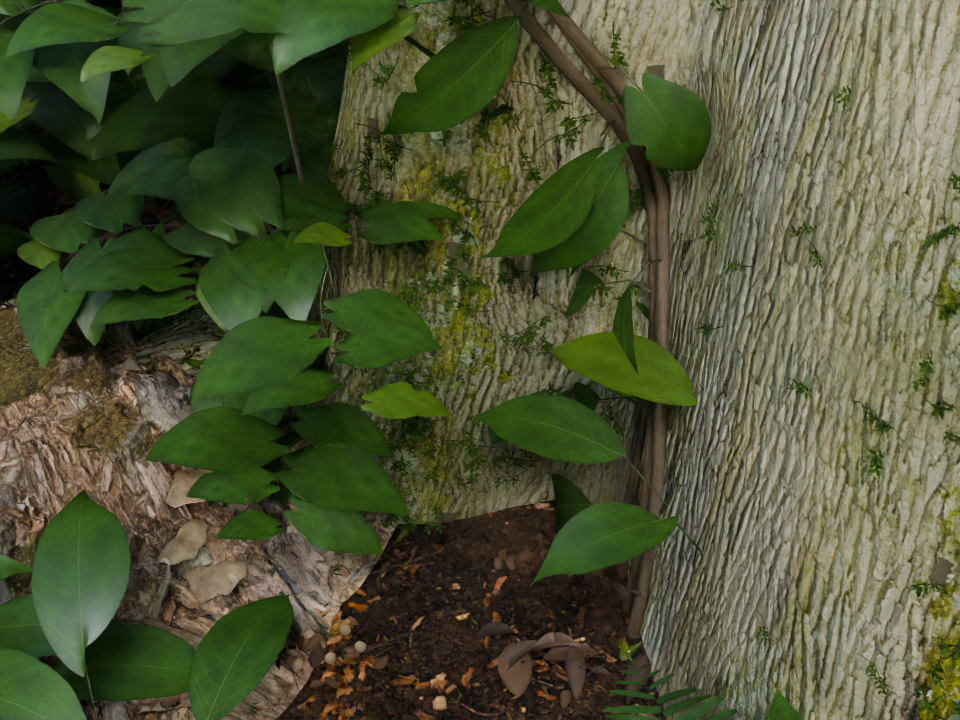
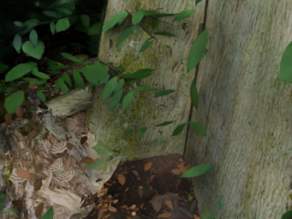

# GREEN TERROR · rainforest studies

Procedural rainforest geometry, botanical asset construction, Cycles rendering, and a recovered native-render pipeline. The source spans several distinct experiments: an A01 leaf study, a later branch/fern/litter asset gate, integrated forest repair, and a V14 rebuild specification.



This is the recovered older forest at 960 × 720 and 32 samples. It demonstrates that the native reconstruction/render/export pipeline ran. Dense repeated foliage, smooth blades and pale bark remain visible. It is not a completed V14 scene or a new photorealism result.


A faithful GIF conversion of the existing four-second branch-inspection film. The camera moves around static geometry, with a lighting cut between two shots. There is no leaf wind or full-forest animation. [Original 960 × 720 MP4](media/branch-inspection.mp4).

## What is here

- `asset_gate/`: the later procedural Piper-like branch, cordate leaf family, fern crown, material atlas generator, inspection renderer and bounded litter-study source. The branch/cordate/fern paths generate their own leaf maps. The substrate patch has additional missing inputs.
- `a01/`: the separate earlier cordate, elliptic and lance leaf construction, vascular maps, blade-boundary constraints, camera tests and forest-integration source. A01 is retained under its own name.
- `integrated_repair/`: recovered code for hierarchical branching, coherent climber-family bindings, fern variation, local litter relaxation, packed-model checks and banded rendering. Supporting legacy source is retained. The full native forest is not included.
- `recovery/`: the portable, hash-checked recovery entry point, EXR enum-compatibility repair, tests and historical render evidence. It requires separately supplied exact native inputs.
- `spec/v14/`: the V14 design, acceptance manifest and review template. This is an unexecuted specification, not an implemented scene or a passed acceptance suite.
- `media/`: two actual recovered pipeline stills, the existing branch film and its README GIF.
- `provenance/`: inherited asset attribution and original checksums, plus the exact publication scope.

## Current status

### Latest structural attempt: 22 October 2026, 15:56 UTC

The newer structural-redesign reports record a **failed control close-up step (exit 1), zero verified stills, no new film and no photorealism approval**. They describe changes to trunk/root silhouettes, distinct plant forms, taller crowns and understory layout. A saved portable model and native reopen are reported, but its bytes were not recovered and reopening alone does not establish renderability. The referenced project archive and usable new structural source were not found in the accessible file inventory.

See [the retained structural status and reports](status/structural-redesign-20261022/README.md). The older verified images and branch film above remain historical evidence; they are not outputs of this newer failed attempt. The full-forest source gap remains open.

This repository is a reviewed source-and-evidence recovery, not a complete final rainforest release. The publication review inspected archive contents, parsed Python/JSON, decoded the existing video, checked media hashes and viewed the recovered images. It did not execute project code, rebuild Blender scenes, rerender images or pass the historical tests again.

The asset-gate archive explicitly says the complete candidate set was not approved for whole-forest replication. The integrated repair and recovery archives describe later native work, but their full models and full asset bundles were not recovered into this checkout. Those revisions must not be conflated.

The V14 final scene, matched native 2K acceptance comparisons and requested ten-second/240-frame 1080p rainforest film are still unavailable. No A01 or V11 artifact has been renamed to imply V14 completion.

## Portable botanical quickstart

Use Python 3.10+ and Blender 4.5 or newer on Windows, macOS or Linux. The launcher discovers Blender from --blender, BLENDER, PATH, or standard Windows/macOS application locations. A missing executable or older version produces a clear error. It starts Blender with factory settings, uses absolute input/output paths and never overwrites an existing working directory.

    python -m venv .venv
    python -m pip install --no-compile -r asset_gate/requirements.txt
    python tools/botanical_study.py --workdir work/branch-check --kind branch

Use the virtual environment's Python for the final two commands (activate it first, or use .venv/Scripts/python on Windows and .venv/bin/python elsewhere). The default is one 320x240, eight-sample static diagnostic render with two CPU threads. It generates the selected family's full-size atlases and original geometry; lower render resolution is only a bounded check. --width, --height, --samples, --threads, --timeout and --blender are explicit controls. Full-quality rendering takes longer and is not implied by this smoke test.

Memory telemetry is peak process resident memory in MiB; unavailable measurements are JSON null, never invented zero. Windows uses its native process counters, macOS corrects the byte-based resource unit, and Linux uses resource KiB. EXR output selects capabilities from the installed Blender RNA rather than assuming a 5.4-only enum.

    python -m unittest discover -s tests -v
    python -m unittest discover -s recovery/src -p test_compat_unit.py -v

The three-OS CI workflow runs source/runtime and EXR compatibility unit checks with fresh host dependencies. It does not install Blender or claim a native render, full forest, wind simulation or completed film. Native render evidence is recorded separately. Keep cybr_runtime.py with the checkout or portable study copy when using individual legacy scripts.

## Windows execution evidence

A fresh isolated Python environment generated full-size Piper atlases, built the procedural branch and rendered a real 320x240, eight-sample Cycles PNG with Blender 4.5.3 LTS. Peak native process memory was 519.93 MiB. The current runtime/core checks and six EXR compatibility tests pass. [Evidence and exact scope](verification/windows-portability/README.md). This is one static branch, not a recovered full forest or a completed film. Three-OS core CI is configured but not yet run remotely.

## Start with the self-contained botanical construction

The archive records Blender 5.4.0 Alpha, build `3fe0f2ab2a29`, CPU Cycles. The portable branch quickstart has now also been executed on Windows with Blender 4.5.3 LTS; this does not establish compatibility of every archived full-forest path. The atlas generator uses host Python with NumPy, SciPy and Pillow; native scene scripts run inside Blender's Python. FFmpeg and FFprobe are needed only for video encoding/inspection.

Use a disposable working copy so reruns do not overwrite the historical evidence in this repository:

```sh
python3 -m venv .venv
. .venv/bin/activate
python3 -m pip install -r asset_gate/requirements.txt
mkdir -p work
cp -R asset_gate work/botanical-study
cp cybr_runtime.py work/botanical-study/
cd work/botanical-study
export BLENDER=/path/to/your/blender

# Generate the numeric leaf maps and vascular networks first.
python3 src/make_atlases.py

# These three study types do not require the omitted scanned substrate.
for kind in branch cordate fern; do
  "$BLENDER" --background --threads 4 --python-exit-code 1 \
    --python src/build_assets.py -- --kind "$kind"
done

"$BLENDER" --background --threads 4 --python-exit-code 1 \
  --python src/render_asset.py -- \
  --scene BRANCH_ASSET_GATE.blend --out renders/branch.png \
  --lighting soft --width 960 --height 720 --samples 32
```

These are source-derived reproduction instructions, not commands rerun during publication. Read `asset_gate/README.md` before using the patch or historical validation scripts. Running the native scripts writes new scenes, renders and evidence into the chosen working copy.

## Full-forest recovery has external prerequisites

`recovery/src/resume.py` checks the exact V11 baseline SHA-256 and refuses an automatic fallback:

```text
16b3a638e8392e298e7169da8d752ef2153d8fab84b9416e8382870bf7eaf17e
```

It also needs the complete `GREEN_TERROR_INTEGRATED_REPAIR_SOURCE.zip` layout and assets, plus a compatible Blender executable. The smaller code-only repair checkpoint in this repository is not a substitute for that complete archive. Native `.blend` inputs and the packed substrate were intentionally excluded because their complete embedded content was not verified for public redistribution. No download link or availability claim is made for the missing full scene.

The recovery code retains input/output hashes, verified stage resumption, native pixel-band assembly and final render/scene identity checks. Six EXR compatibility tests now pass again, and a separate native EXR smoke passes on Blender 4.5.3. These do not exercise the missing full-forest inputs.

## How the botanical models work

- A prescribed asymmetric main/secondary vein graph is extended with attractor-directed fine branching and sparse terminal connections. This is inspired by [Runions et al. (2005)](https://algorithmicbotany.org/papers/venation.sig2005.html), not a faithful implementation of the complete growth model.
- Albedo, thickness, roughness, relief and geometric veins share numeric construction and UV parameterization. The new leaf textures are generated from numeric fields rather than projected reference photographs.
- Blades have upper/lower surfaces and closed edges; selected underside veins and fern sori are modeled. Repeated/instanced forms remain visible.
- The bounded asset gate seats curled litter on a support raster. The later integrated-repair source adds local position-based relaxation and rejection checks. Neither is a global collision-free cloth or ecological simulation.
- The recovery renderer separates native radiance and guides, assembles pixel bands without rescaling, denoises and applies the display transform. Its existing proof is evidence of that historical pipeline, not convergence or visual acceptance.

## Media and verification

The MP4's bytes match its saved native delivery record: 960 × 720, 24 fps, four seconds, 96 decoded frames and 96 distinct decoded hashes. The README GIF reduces this existing footage to 640 × 480 at 12 fps and loops for display. It does not synthesize motion or interpolate frames.



The later test is only 320 × 240, shown at native size. Its generic original filename did not establish final quality. It is preserved as a pipeline test, not a realism comparison.

See [media/provenance.json](media/provenance.json) for byte hashes, conversions and review scope. Historical reports refer to past outputs, including files not included here. Paths in retained source/records were normalized where needed; historical hashes describe the original artifacts, not a new execution.

## Known limitations

- Repeated leaf/fern forms, overly smooth tissue and simplified cylindrical stems remain.
- Some litter candidates look paper-like or sit too prominently above support. The asset-gate review did not approve forest-wide replication.
- Material coefficients are authored approximations, not measured spectral scattering data or specimen-calibrated botany.
- Whole-forest source paths require external native inputs and a compatible historical runtime. A01 and legacy scripts are archival paths, not the default quickstart.
- No real wind solver, ecological growth validation, final V14 model, final rainforest motion film or photorealism certification is included.

## Provenance and rights

The inherited source identifies Poly Haven scan assets including bark, soil and deadwood. Their original asset records, artists and checksums are preserved in [provenance/ORIGINAL_ASSET_MANIFEST.json](provenance/ORIGINAL_ASSET_MANIFEST.json). Poly Haven identifies its assets as CC0 on its [asset-license page](https://polyhaven.com/license); that applies to those third-party assets, not to every file in this repository.

No raw third-party photographs, scanned texture maps, native packed models, environment credentials, runtime archives or private account identifiers are included. Reference photographs are documented as references, not redistributed textures. See [THIRD_PARTY_NOTICES.md](THIRD_PARTY_NOTICES.md) and [provenance/PUBLICATION-SCOPE.md](provenance/PUBLICATION-SCOPE.md).

No new blanket software or artwork license is granted by this publication. Existing third-party terms remain with their respective material.
