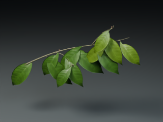

# Windows botanical portability evidence
Verified 22 October 2026 on Windows, Python 3.12 and Blender 4.5.3 LTS.

This is the actual 320x240, eight-sample Cycles PNG from a fresh virtual environment, new full-size Piper atlas generation and original branch geometry. It is a static botanical study. No fake scene, image generation or replacement texture was used. The first complete pipeline took 285.6 seconds and used four Blender threads; the launcher now defaults to two and a subsequent native 80x60, two-sample multilayer EXR check used two threads and passed. Default render bounds are diagnostics, not final-quality settings.

Commands from the repository root, using the virtual environment's Python:

    python -m pip install --no-compile -r asset_gate/requirements.txt
    python -m unittest discover -s tests -v
    python -m unittest discover -s recovery/src -p test_compat_unit.py -v
    python tools/botanical_study.py --workdir work/branch-check --kind branch --threads 2

Observed: five runtime/source unit tests and six EXR compatibility unit tests pass. New native single/multilayer EXR tests pass. The pipeline dependencies were NumPy 2.5.4, SciPy 1.18.1 and Pillow 13.0.0. Installation was slow on this drive; the earlier 180-second install cap was not a dependency incompatibility.

The original Windows resource import failure is fixed by real native memory counters, with null for unavailable telemetry. Absolute paths prevent Blender from writing to its unrelated working directory. RNA capability checks replace the 5.4-only EXR setting. Optional allocator/debug controls no longer assume glibc or one Blender build.

See [native-render.json](native-render.json) for image/scene hashes and measured 519.93 MiB peak native process memory. Three-OS CI is configured for source/runtime checks; macOS/Linux results are not yet available. This does not validate all archival scripts, external scanned substrates, full-forest recovery, V14, wind or a completed film. The full native forest and exact recovery inputs remain missing.
